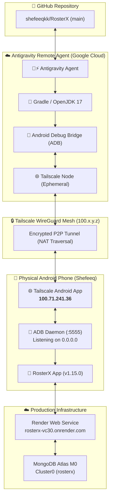

# 🌐 RosterX - Antigravity Remote Agent & Tailscale Wireless ADB Guide

> **Version:** `1.15.0`  
> **Target Device Tailscale Static IP:** `100.71.241.36`  
> **Production Cloud:** Render (`https://rosterx-vc30.onrender.com`)  
> **Monorepo:** GitHub [`https://github.com/shefeeqkk/RosterX.git`](https://github.com/shefeeqkk/RosterX.git)

---

## 🏗️ 1. Architecture Overview

When developing with the **Antigravity Remote Agent** in Google Cloud, the agent has no physical USB connection to your phone. By placing both the Cloud Remote Agent and your Android phone onto a **Tailscale WireGuard Mesh Network**, the remote agent can directly address, compile, install, and debug on your phone wirelessly as if it were plugged into a local USB port!



---

## ⚡ 2. Handling Multiple Wi-Fi Networks & Changing IPs (Seamless Strategy)

### ❓ The Challenge
When you move between **Home Wi-Fi**, **Office Wi-Fi**, or **Mobile Data (5G/4G)**:
- Your local LAN IP (`192.168.1.x` or `10.x.x.x`) changes constantly.
- Android 11+ built-in "Wireless Debugging" changes its 5-digit port (e.g. `39233`, `41852`) every time Wi-Fi reconnects.

### 💡 The Solution: Fixed Tailscale IP + Persistent Port 5555
1. **Permanent Tailscale IP (`100.71.241.36`)**:
   - Tailscale assigns your phone a static CGNAT IP (`100.71.241.36`) that **never changes**, regardless of which Wi-Fi network or cellular carrier you connect to.
2. **Persistent Port 5555 (`adb tcpip 5555`)**:
   - Binding the ADB daemon to port 5555 once via `adb tcpip 5555` makes it listen on `0.0.0.0:5555` across all network interfaces, including Tailscale's `tun0`.
   - **It survives Wi-Fi switches, network drops, and sleep cycles indefinitely.**
   - Only a full phone reboot resets port 5555.
3. **Dynamic Port Fallback**:
   - If your phone is ever rebooted, `./scripts/remote-deploy.sh` automatically detects the timeout and prompts you to enter the temporary 5-digit port shown in *Developer Options > Wireless Debugging*, or accepts it as an argument:
     ```bash
     ./scripts/remote-deploy.sh 100.71.241.36 <PORT>
     ```

---

## 🚀 3. Step-by-Step Remote Agent Setup

### Step 1: Connect GitHub Repository
In the Antigravity Remote Agent environment or initialization prompt:
1. Connect your repository: `https://github.com/shefeeqkk/RosterX.git`.
2. Select branch: `main`.

### Step 2: Generate Tailscale Ephemeral Auth Key
1. Go to your **[Tailscale Admin Console](https://login.tailscale.com/admin/settings/keys)**.
2. Navigate to **Settings > Keys > Generate auth key**.
3. Settings:
   - **Reusable**: Optional (Recommended for convenience).
   - **Ephemeral**: **Enabled** (Ensures the cloud VM automatically disappears from your Tailscale device list when the session terminates).
   - **Pre-authorized**: **Enabled** (No manual admin approval needed).
4. Copy the generated auth key from the Tailscale Admin Console.

### Step 3: Configure Environment Secrets in Remote Agent
In your Antigravity Remote Agent settings or terminal session, configure the following environment variables:

```bash
export TAILSCALE_AUTHKEY="<YOUR_TAILSCALE_AUTH_KEY>"
export TAILSCALE_PHONE_IP="100.71.241.36"
export ADB_PORT="5555"

# Backend & AI secrets (for running server/tests if needed)
export MONGODB_URI="mongodb+srv://..."
export JWT_SECRET="..."
export GEMINI_API_KEY="..."
```

### Step 4: One-Time Phone Setup
1. **Tailscale App on Phone**: Ensure Tailscale is installed, turned ON, and your phone displays IP `100.71.241.36`.
2. **Developer Options on Phone**:
   - Enable **Developer Options** (tap Build Number 7 times).
   - Enable **USB Debugging** and **Wireless Debugging**.
3. **Bind Port 5555** (Run once until next reboot):
   - If connected via local computer USB/Wi-Fi:
     ```bash
     adb tcpip 5555
     ```
   - *Note:* Once executed, you can unplug the USB cable. As long as the phone remains powered on, port 5555 remains active over Tailscale regardless of Wi-Fi changes!

---

## 🛠️ 4. Running Scripts on the Remote Agent

### 1. Provision the Environment (Run Once per Remote Agent Session)
```bash
./scripts/setup-remote-agent.sh
```
This automatically:
- Installs OpenJDK 17, ADB, netcat, Python 3, and build utilities.
- Installs Tailscale and authenticates headlessly using `$TAILSCALE_AUTHKEY`.
- Makes `android/gradlew` executable.
- Installs Python dependencies (`pymongo`, `dnspython`).

### 2. Verify Connectivity
```bash
./scripts/tailscale-connect.sh
```
This tests:
- Local Tailscale IP and node status.
- Direct ping to phone (`100.71.241.36`).
- TCP socket reachability on port `5555`.

### 3. Build & Wirelessly Deploy APK to Phone
```bash
# Standard deployment (uses 100.71.241.36:5555)
./scripts/remote-deploy.sh

# Fallback deployment (if phone rebooted and Wireless Debugging is on dynamic port)
./scripts/remote-deploy.sh 100.71.241.36 39233
```
This script will:
1. Connect ADB to `100.71.241.36:5555` via the Tailscale tunnel.
2. Compile the native Android APK using `./gradlew assembleDebug --no-daemon`.
3. Wirelessly push and install `app-debug.apk` onto your physical phone.
4. Launch the `MainActivity`.
5. Capture a verification screenshot and pull it to `remote_deploy_verify.png`.

---

## 📱 5. Quick Reference ADB Commands over Tailscale

From anywhere in the Antigravity Remote Agent terminal:

| Action | Command |
| :--- | :--- |
| **Check connected devices** | `adb devices` |
| **View live logcat** | `adb -s 100.71.241.36:5555 logcat -d -s RosterX` |
| **Take screenshot** | `adb -s 100.71.241.36:5555 shell screencap -p /sdcard/s.png && adb pull /sdcard/s.png` |
| **Restart App** | `adb -s 100.71.241.36:5555 shell am force-stop com.rosterx.app && adb -s 100.71.241.36:5555 shell am start -n com.rosterx.app/.MainActivity` |
| **Open Remote Shell** | `adb -s 100.71.241.36:5555 shell` |

---
*Maintained with 👵⚡ care by Aunty for Shefeeq's high-velocity RosterX development.*

